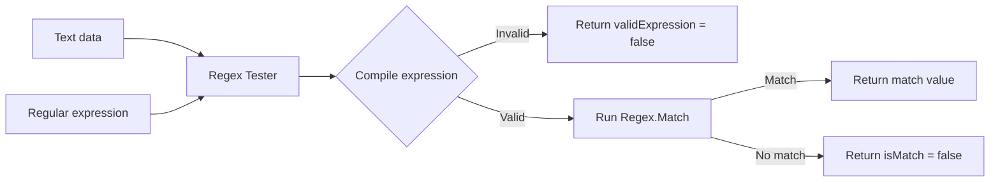
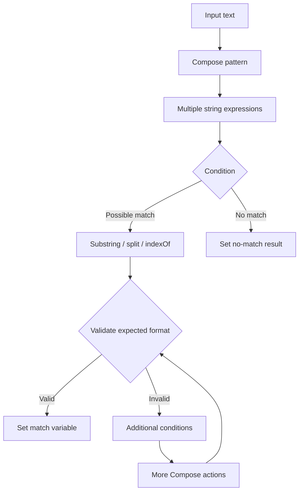

# Regex Tester

## Description

**Regex Tester** accepts a text value and a regular expression, validates the expression, tests it against the supplied text, and returns whether it matched plus the first matching value.

This is useful when a Power Automate flow would otherwise contain repeated expressions, string manipulation, conditions, and validation steps merely to locate structured values such as incident numbers, reference numbers, environment names, priorities, or identifiers.

## Connector summary

| Detail | Value |
|---|---|
| Connector | Regex Tester |
| Host | `api.local` |
| Base path | `/` |
| Operation | `POST /regex/test` |
| Operation ID | `TestRegex` |
| Input | `data`, `expression` |
| Main outputs | `validExpression`, `isMatch`, `match`, `error` |
| Backend call required | No — custom code returns the response |

## How the connector works



## What the Power Automate alternative can become



The connector replaces the flow-level parsing with one reusable action.

## Swagger 2.0

```yaml
swagger: '2.0'

info:
  title: Regex Tester
  description: Tests a regular expression against supplied text using custom C# code.
  version: '1.0'

host: api.local

basePath: /

schemes:
  - https

consumes:
  - application/json

produces:
  - application/json

paths:
  /regex/test:
    post:
      summary: Test Regular Expression
      description: Tests a regular expression against the supplied data.
      operationId: TestRegex
      x-ms-visibility: important

      parameters:
        - name: body
          in: body
          required: true
          schema:
            type: object
            required:
              - data
              - expression
            properties:
              data:
                type: string
                description: The text that the regular expression will be tested against.
                x-ms-summary: Data
                example: 'Incident INC-12345 has priority P1'

              expression:
                type: string
                description: The regular expression to test.
                x-ms-summary: Regular Expression
                example: '\bINC-\d+\b'

      responses:
        '200':
          description: Regex test completed successfully.
          schema:
            type: object
            properties:
              validExpression:
                type: boolean
              isMatch:
                type: boolean
              match:
                type: string
                x-nullable: true
              error:
                type: string
                x-nullable: true

        '400':
          description: Invalid request.
          schema:
            type: object
            properties:
              error:
                type: string

definitions: {}
```

## C# custom connector code

```csharp
public class Script : ScriptBase
{
    public override async Task<HttpResponseMessage> ExecuteAsync()
    {
        return await TestRegex();
    }

    private async Task<HttpResponseMessage> TestRegex()
    {
        var requestBody =
            await this.Context.Request.Content.ReadAsStringAsync();

        JObject input;

        try
        {
            input = JObject.Parse(requestBody);
        }
        catch
        {
            return CreateBadRequestResponse(
                "The request body must contain valid JSON."
            );
        }

        var data =
            input["data"]?.ToString();

        var expression =
            input["expression"]?.ToString();

        if (data == null)
        {
            return CreateBadRequestResponse(
                "The 'data' property is required."
            );
        }

        if (string.IsNullOrWhiteSpace(expression))
        {
            return CreateBadRequestResponse(
                "The 'expression' property is required."
            );
        }

        try
        {
            var regex = new Regex(expression);
            var match = regex.Match(data);

            var result = new JObject
            {
                ["validExpression"] = true,
                ["isMatch"] = match.Success,
                ["match"] = match.Success ? match.Value : null,
                ["error"] = null
            };

            return CreateJsonResponse(
                HttpStatusCode.OK,
                result
            );
        }
        catch (ArgumentException ex)
        {
            var result = new JObject
            {
                ["validExpression"] = false,
                ["isMatch"] = false,
                ["match"] = null,
                ["error"] = ex.Message
            };

            return CreateJsonResponse(
                HttpStatusCode.OK,
                result
            );
        }
    }

    private HttpResponseMessage CreateBadRequestResponse(string message)
    {
        var result = new JObject
        {
            ["error"] = message
        };

        return CreateJsonResponse(
            HttpStatusCode.BadRequest,
            result
        );
    }

    private HttpResponseMessage CreateJsonResponse(
        HttpStatusCode statusCode,
        JObject body)
    {
        var response = new HttpResponseMessage(statusCode);
        response.Content = CreateJsonContent(body.ToString());
        return response;
    }
}
```

## Sample request — match found

```json
{
  "data": "There is a problem with incident INC-0009281 in production.",
  "expression": "\\bINC-\\d+\\b"
}
```

### Expected result

```json
{
  "validExpression": true,
  "isMatch": true,
  "match": "INC-0009281",
  "error": null
}
```

## Sample request — valid expression, no match

```json
{
  "data": "Everything is working normally.",
  "expression": "\\bINC-\\d+\\b"
}
```

### Expected result

```json
{
  "validExpression": true,
  "isMatch": false,
  "match": null,
  "error": null
}
```

## Sample request — invalid expression

```json
{
  "data": "Incident INC-12345",
  "expression": "[A-Z"
}
```

### Expected result

```json
{
  "validExpression": false,
  "isMatch": false,
  "match": null,
  "error": "A regex parsing error message is returned here."
}
```

## Design notes

- The current version returns the **first match**.
- It can easily be extended to return all matches using `Regex.Matches()`.
- Treat caller-supplied regular expressions as potentially expensive. Avoid allowing untrusted users to submit pathological expressions in high-volume production scenarios.
- Returning `validExpression` separately from `isMatch` makes the operation easier to consume in a flow.

## Good demo scenario

Use an email subject such as:

`[P1] RE: Incident INC-0009281 affecting PROD-EU2`

and test expressions for incident number, priority, or environment. It demonstrates how a small amount of C# can replace a collection of brittle text expressions.


## Power Platform implementation note

These examples are designed for the **Custom Code** feature in a Microsoft Power Platform custom connector.

- Host used in the examples: `api.local`
- Protocol: `HTTPS`
- Definition format: Swagger / OpenAPI 2.0
- Custom code entry point: `public class Script : ScriptBase`
- The script returns its own `HttpResponseMessage`; it does **not** call `Context.SendAsync()`.
- When custom code is enabled for the operation, Microsoft documents that the custom code takes precedence over the codeless definition, so the request does not need to be forwarded to the backend.
- Microsoft currently documents .NET Standard 2.0 and a restricted set of supported namespaces for custom connector code.
- Platform limits can change. Test payload size and execution time in the target tenant before using these patterns for high-volume production workloads.

> `api.local` is intentionally used as a placeholder host for these demonstrations. If your governance or import tooling requires a resolvable host, replace it with an HTTPS endpoint you control even when the custom code returns without forwarding the request.

### Official Microsoft references

- Write code in a custom connector: https://learn.microsoft.com/en-us/connectors/custom-connectors/write-code
- Create a custom connector from scratch: https://learn.microsoft.com/en-us/connectors/custom-connectors/define-blank
- Custom connector FAQ: https://learn.microsoft.com/en-in/connectors/custom-connectors/faq
