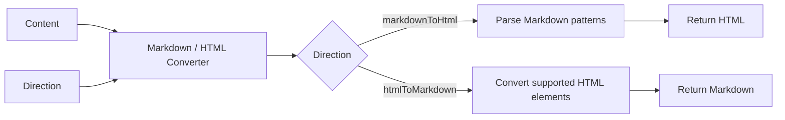
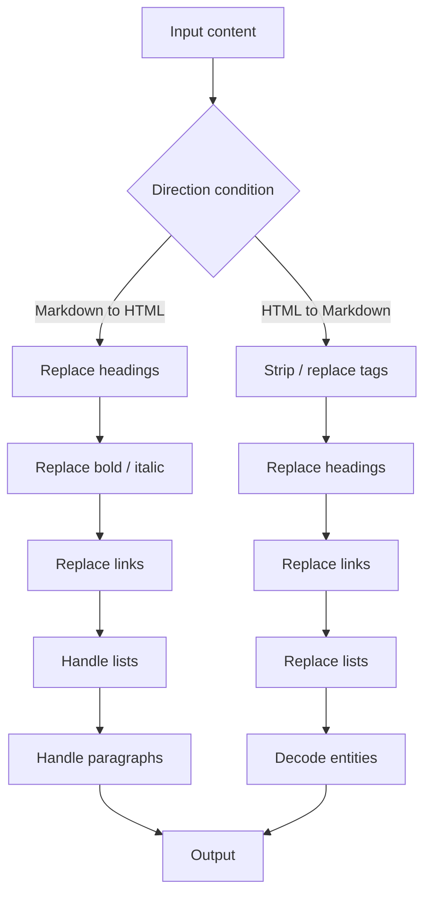

# Markdown / HTML Converter

## Description

**Markdown / HTML Converter** converts content in either direction:

- Markdown → HTML
- HTML → Markdown

The direction is supplied as an enum, so Power Automate can present it as a dropdown. The connector uses a lightweight conversion implementation suitable for demonstrations and controlled content without relying on external NuGet packages.

## Connector summary

| Detail | Value |
|---|---|
| Connector | Markdown / HTML Converter |
| Host | `api.local` |
| Base path | `/` |
| Operation | `POST /convert` |
| Operation ID | `ConvertContent` |
| Direction values | `markdownToHtml`, `htmlToMarkdown` |
| Main input | `content` |
| Main output | `output` |
| Backend call required | No |

## How the connector works



## What the Power Automate alternative can become



A flow-based implementation quickly becomes a long sequence of Compose and Replace operations, particularly when both directions are required.

## Swagger 2.0

```yaml
swagger: '2.0'

info:
  title: Markdown HTML Converter
  description: Converts content between Markdown and HTML using custom C# code.
  version: '1.0'

host: api.local

basePath: /

schemes:
  - https

consumes:
  - application/json

produces:
  - application/json

paths:
  /convert:
    post:
      summary: Convert Markdown and HTML
      description: Converts Markdown to HTML or HTML to Markdown.
      operationId: ConvertContent
      x-ms-visibility: important

      parameters:
        - name: body
          in: body
          required: true
          schema:
            type: object
            required:
              - direction
              - content
            properties:
              direction:
                type: string
                description: Select the direction of the conversion.
                x-ms-summary: Conversion Direction
                enum:
                  - markdownToHtml
                  - htmlToMarkdown

              content:
                type: string
                description: The Markdown or HTML content to convert.
                x-ms-summary: Content
                example: '# Hello World'

      responses:
        '200':
          description: Conversion completed successfully.
          schema:
            type: object
            properties:
              success:
                type: boolean
              direction:
                type: string
              output:
                type: string
                x-nullable: true
              error:
                type: string
                x-nullable: true

        '400':
          description: Invalid request.
          schema:
            type: object
            properties:
              success:
                type: boolean
              error:
                type: string

definitions: {}
```

## C# custom connector code

```csharp
public class Script : ScriptBase
{
    public override async Task<HttpResponseMessage> ExecuteAsync()
    {
        return await ConvertContent();
    }

    private async Task<HttpResponseMessage> ConvertContent()
    {
        var requestBody =
            await this.Context.Request.Content.ReadAsStringAsync();

        JObject input;

        try
        {
            input = JObject.Parse(requestBody);
        }
        catch
        {
            return CreateBadRequestResponse(
                "The request body must contain valid JSON."
            );
        }

        var direction = input["direction"]?.ToString();
        var content = input["content"]?.ToString();

        if (string.IsNullOrWhiteSpace(direction))
        {
            return CreateBadRequestResponse(
                "The 'direction' property is required."
            );
        }

        if (content == null)
        {
            return CreateBadRequestResponse(
                "The 'content' property is required."
            );
        }

        try
        {
            string output;

            switch (direction)
            {
                case "markdownToHtml":
                    output = MarkdownToHtml(content);
                    break;

                case "htmlToMarkdown":
                    output = HtmlToMarkdown(content);
                    break;

                default:
                    return CreateBadRequestResponse(
                        "Direction must be 'markdownToHtml' or 'htmlToMarkdown'."
                    );
            }

            var result = new JObject
            {
                ["success"] = true,
                ["direction"] = direction,
                ["output"] = output,
                ["error"] = null
            };

            return CreateJsonResponse(HttpStatusCode.OK, result);
        }
        catch (Exception ex)
        {
            var result = new JObject
            {
                ["success"] = false,
                ["direction"] = direction,
                ["output"] = null,
                ["error"] = ex.Message
            };

            return CreateJsonResponse(HttpStatusCode.OK, result);
        }
    }

    private string MarkdownToHtml(string markdown)
    {
        if (string.IsNullOrEmpty(markdown))
        {
            return string.Empty;
        }

        markdown = markdown
            .Replace("\r\n", "\n")
            .Replace("\r", "\n");

        var lines = markdown.Split('\n');
        var html = new StringBuilder();

        bool inUnorderedList = false;
        bool inOrderedList = false;

        foreach (var originalLine in lines)
        {
            var line = originalLine;

            if (line.StartsWith("###### "))
            {
                CloseLists(html, ref inUnorderedList, ref inOrderedList);
                html.Append("<h6>" + ProcessInlineMarkdown(line.Substring(7)) + "</h6>");
                continue;
            }

            if (line.StartsWith("##### "))
            {
                CloseLists(html, ref inUnorderedList, ref inOrderedList);
                html.Append("<h5>" + ProcessInlineMarkdown(line.Substring(6)) + "</h5>");
                continue;
            }

            if (line.StartsWith("#### "))
            {
                CloseLists(html, ref inUnorderedList, ref inOrderedList);
                html.Append("<h4>" + ProcessInlineMarkdown(line.Substring(5)) + "</h4>");
                continue;
            }

            if (line.StartsWith("### "))
            {
                CloseLists(html, ref inUnorderedList, ref inOrderedList);
                html.Append("<h3>" + ProcessInlineMarkdown(line.Substring(4)) + "</h3>");
                continue;
            }

            if (line.StartsWith("## "))
            {
                CloseLists(html, ref inUnorderedList, ref inOrderedList);
                html.Append("<h2>" + ProcessInlineMarkdown(line.Substring(3)) + "</h2>");
                continue;
            }

            if (line.StartsWith("# "))
            {
                CloseLists(html, ref inUnorderedList, ref inOrderedList);
                html.Append("<h1>" + ProcessInlineMarkdown(line.Substring(2)) + "</h1>");
                continue;
            }

            if (
                line.Trim() == "---" ||
                line.Trim() == "***" ||
                line.Trim() == "___")
            {
                CloseLists(html, ref inUnorderedList, ref inOrderedList);
                html.Append("<hr />");
                continue;
            }

            if (line.StartsWith("> "))
            {
                CloseLists(html, ref inUnorderedList, ref inOrderedList);
                html.Append(
                    "<blockquote>" +
                    ProcessInlineMarkdown(line.Substring(2)) +
                    "</blockquote>");
                continue;
            }

            if (line.StartsWith("- ") || line.StartsWith("* "))
            {
                if (inOrderedList)
                {
                    html.Append("</ol>");
                    inOrderedList = false;
                }

                if (!inUnorderedList)
                {
                    html.Append("<ul>");
                    inUnorderedList = true;
                }

                html.Append(
                    "<li>" +
                    ProcessInlineMarkdown(line.Substring(2)) +
                    "</li>");

                continue;
            }

            var orderedMatch = Regex.Match(
                line,
                @"^\d+\.\s+(.*)$"
            );

            if (orderedMatch.Success)
            {
                if (inUnorderedList)
                {
                    html.Append("</ul>");
                    inUnorderedList = false;
                }

                if (!inOrderedList)
                {
                    html.Append("<ol>");
                    inOrderedList = true;
                }

                html.Append(
                    "<li>" +
                    ProcessInlineMarkdown(orderedMatch.Groups[1].Value) +
                    "</li>");

                continue;
            }

            CloseLists(html, ref inUnorderedList, ref inOrderedList);

            if (string.IsNullOrWhiteSpace(line))
            {
                continue;
            }

            html.Append(
                "<p>" +
                ProcessInlineMarkdown(line) +
                "</p>");
        }

        CloseLists(html, ref inUnorderedList, ref inOrderedList);

        return html.ToString();
    }

    private string ProcessInlineMarkdown(string text)
    {
        if (string.IsNullOrEmpty(text))
        {
            return string.Empty;
        }

        text = WebUtility.HtmlEncode(text);

        text = Regex.Replace(
            text,
            @"`([^`]+)`",
            "<code>$1</code>"
        );

        text = Regex.Replace(
            text,
            @"\[([^\]]+)\]\(([^\)]+)\)",
            "<a href=\"$2\">$1</a>"
        );

        text = Regex.Replace(
            text,
            @"\*\*(.+?)\*\*",
            "<strong>$1</strong>"
        );

        text = Regex.Replace(
            text,
            @"__(.+?)__",
            "<strong>$1</strong>"
        );

        text = Regex.Replace(
            text,
            @"(?<!\*)\*([^*]+)\*(?!\*)",
            "<em>$1</em>"
        );

        text = Regex.Replace(
            text,
            @"(?<!_)_([^_]+)_(?!_)",
            "<em>$1</em>"
        );

        return text;
    }

    private void CloseLists(
        StringBuilder html,
        ref bool inUnorderedList,
        ref bool inOrderedList)
    {
        if (inUnorderedList)
        {
            html.Append("</ul>");
            inUnorderedList = false;
        }

        if (inOrderedList)
        {
            html.Append("</ol>");
            inOrderedList = false;
        }
    }

    private string HtmlToMarkdown(string html)
    {
        if (string.IsNullOrEmpty(html))
        {
            return string.Empty;
        }

        var markdown = html;

        markdown = Regex.Replace(
            markdown,
            @"<script\b[^>]*>[\s\S]*?</script>",
            "",
            RegexOptions.IgnoreCase
        );

        markdown = Regex.Replace(
            markdown,
            @"<style\b[^>]*>[\s\S]*?</style>",
            "",
            RegexOptions.IgnoreCase
        );

        markdown = ReplaceElement(markdown, "h1", "# $1\n\n");
        markdown = ReplaceElement(markdown, "h2", "## $1\n\n");
        markdown = ReplaceElement(markdown, "h3", "### $1\n\n");
        markdown = ReplaceElement(markdown, "h4", "#### $1\n\n");
        markdown = ReplaceElement(markdown, "h5", "##### $1\n\n");
        markdown = ReplaceElement(markdown, "h6", "###### $1\n\n");

        markdown = Regex.Replace(
            markdown,
            @"<(strong|b)\b[^>]*>(.*?)</\1>",
            "**$2**",
            RegexOptions.IgnoreCase | RegexOptions.Singleline
        );

        markdown = Regex.Replace(
            markdown,
            @"<(em|i)\b[^>]*>(.*?)</\1>",
            "*$2*",
            RegexOptions.IgnoreCase | RegexOptions.Singleline
        );

        markdown = Regex.Replace(
            markdown,
            @"<code\b[^>]*>(.*?)</code>",
            "`$1`",
            RegexOptions.IgnoreCase | RegexOptions.Singleline
        );

        markdown = Regex.Replace(
            markdown,
            @"<a\b[^>]*href\s*=\s*[""']([^""']+)[""'][^>]*>(.*?)</a>",
            "[$2]($1)",
            RegexOptions.IgnoreCase | RegexOptions.Singleline
        );

        markdown = Regex.Replace(
            markdown,
            @"<blockquote\b[^>]*>(.*?)</blockquote>",
            "> $1\n\n",
            RegexOptions.IgnoreCase | RegexOptions.Singleline
        );

        markdown = Regex.Replace(
            markdown,
            @"<li\b[^>]*>(.*?)</li>",
            "- $1\n",
            RegexOptions.IgnoreCase | RegexOptions.Singleline
        );

        markdown = Regex.Replace(
            markdown,
            @"</?(ul|ol)\b[^>]*>",
            "\n",
            RegexOptions.IgnoreCase
        );

        markdown = Regex.Replace(
            markdown,
            @"<p\b[^>]*>(.*?)</p>",
            "$1\n\n",
            RegexOptions.IgnoreCase | RegexOptions.Singleline
        );

        markdown = Regex.Replace(
            markdown,
            @"<br\s*/?>",
            "\n",
            RegexOptions.IgnoreCase
        );

        markdown = Regex.Replace(
            markdown,
            @"<hr\s*/?>",
            "\n---\n",
            RegexOptions.IgnoreCase
        );

        markdown = Regex.Replace(
            markdown,
            @"<[^>]+>",
            ""
        );

        markdown = WebUtility.HtmlDecode(markdown);

        markdown = Regex.Replace(
            markdown,
            @"\n{3,}",
            "\n\n"
        );

        return markdown.Trim();
    }

    private string ReplaceElement(
        string input,
        string element,
        string replacement)
    {
        return Regex.Replace(
            input,
            "<" + element + @"\b[^>]*>(.*?)</" + element + ">",
            replacement,
            RegexOptions.IgnoreCase | RegexOptions.Singleline
        );
    }

    private HttpResponseMessage CreateBadRequestResponse(string message)
    {
        var result = new JObject
        {
            ["success"] = false,
            ["error"] = message
        };

        return CreateJsonResponse(HttpStatusCode.BadRequest, result);
    }

    private HttpResponseMessage CreateJsonResponse(
        HttpStatusCode statusCode,
        JObject body)
    {
        var response = new HttpResponseMessage(statusCode);
        response.Content = CreateJsonContent(body.ToString());
        return response;
    }
}
```

## Sample payload — Markdown to HTML

```json
{
  "direction": "markdownToHtml",
  "content": "# Power Platform\n\nThis is **really useful**.\n\n- Power Apps\n- Power Automate\n- Dataverse"
}
```

### Expected result

```json
{
  "success": true,
  "direction": "markdownToHtml",
  "output": "<h1>Power Platform</h1><p>This is <strong>really useful</strong>.</p><ul><li>Power Apps</li><li>Power Automate</li><li>Dataverse</li></ul>",
  "error": null
}
```

## Sample payload — HTML to Markdown

```json
{
  "direction": "htmlToMarkdown",
  "content": "<h1>Power Platform</h1><p>This is <strong>really useful</strong>.</p><ul><li>Power Apps</li><li>Power Automate</li><li>Dataverse</li></ul>"
}
```

### Expected result

```text
# Power Platform

This is **really useful**.

- Power Apps
- Power Automate
- Dataverse
```

## Supported subset

The lightweight implementation covers common constructs:

- H1–H6 headings
- Bold and italic
- Inline code
- Links
- Ordered and unordered lists
- Blockquotes
- Paragraphs and line breaks
- Horizontal rules

## Limitations

This is **not a complete Markdown specification implementation** and it is **not a general-purpose HTML parser**.

Consider a dedicated conversion service for:

- deeply nested HTML,
- complex nested lists,
- tables,
- fenced code blocks with language metadata,
- embedded media,
- malformed HTML,
- advanced Markdown extensions.

The limited scope is useful for a demo because it makes the value of moving transformation logic out of a flow very visible.


## Power Platform implementation note

These examples are designed for the **Custom Code** feature in a Microsoft Power Platform custom connector.

- Host used in the examples: `api.local`
- Protocol: `HTTPS`
- Definition format: Swagger / OpenAPI 2.0
- Custom code entry point: `public class Script : ScriptBase`
- The script returns its own `HttpResponseMessage`; it does **not** call `Context.SendAsync()`.
- When custom code is enabled for the operation, Microsoft documents that the custom code takes precedence over the codeless definition, so the request does not need to be forwarded to the backend.
- Microsoft currently documents .NET Standard 2.0 and a restricted set of supported namespaces for custom connector code.
- Platform limits can change. Test payload size and execution time in the target tenant before using these patterns for high-volume production workloads.

> `api.local` is intentionally used as a placeholder host for these demonstrations. If your governance or import tooling requires a resolvable host, replace it with an HTTPS endpoint you control even when the custom code returns without forwarding the request.

### Official Microsoft references

- Write code in a custom connector: https://learn.microsoft.com/en-us/connectors/custom-connectors/write-code
- Create a custom connector from scratch: https://learn.microsoft.com/en-us/connectors/custom-connectors/define-blank
- Custom connector FAQ: https://learn.microsoft.com/en-in/connectors/custom-connectors/faq
