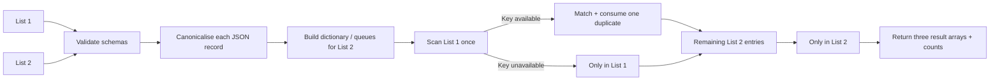
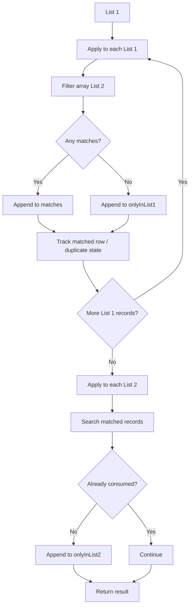

# Compare JSON Lists

## Description

**Compare JSON Lists** compares two JSON arrays of objects and returns:

- records present in both lists,
- records only in List 1,
- records only in List 2,
- counts for each category.

The number and names of columns are discovered at runtime. Both lists must use the same set of column names. Property order does not matter, and duplicate records are handled as individual occurrences.

This is designed to replace patterns such as:

`Apply to each → Filter array → nested loops → variables → duplicate handling`

## Connector summary

| Detail | Value |
|---|---|
| Connector | Compare JSON Lists |
| Host | `api.local` |
| Base path | `/` |
| Operation | `POST /compare` |
| Operation ID | `CompareJsonLists` |
| Inputs | `list1`, `list2` |
| Outputs | `matches`, `onlyInList1`, `onlyInList2`, counts |
| Comparison | Entire record |
| Duplicate aware | Yes |
| Property-order independent | Yes |
| Backend call required | No |

## How the connector works



## What the Power Automate alternative can become



For large lists the nested scanning pattern can be significantly less efficient than indexing one list and then doing lookups.

## Comparison behaviour

These two records are treated as equal because JSON object property order is not significant:

```json
{
  "id": 1,
  "name": "Ian"
}
```

```json
{
  "name": "Ian",
  "id": 1
}
```

Duplicate occurrences are counted separately.

## Swagger 2.0

```yaml
swagger: '2.0'

info:
  title: Compare JSON Lists
  description: Compares two JSON arrays and returns matching and differing records.
  version: '1.0'

host: api.local

basePath: /

schemes:
  - https

consumes:
  - application/json

produces:
  - application/json

paths:
  /compare:
    post:
      summary: Compare JSON Lists
      description: Compares two JSON arrays containing objects with the same set of properties.
      operationId: CompareJsonLists

      parameters:
        - name: body
          in: body
          required: true
          schema:
            type: object
            required:
              - list1
              - list2
            properties:
              list1:
                type: array
                description: The first JSON array to compare.
                x-ms-summary: First List
                items:
                  type: object
                  additionalProperties: {}

              list2:
                type: array
                description: The second JSON array to compare.
                x-ms-summary: Second List
                items:
                  type: object
                  additionalProperties: {}

      responses:
        '200':
          description: Comparison completed successfully.
          schema:
            type: object
            properties:
              success:
                type: boolean
              list1Count:
                type: integer
                format: int32
              list2Count:
                type: integer
                format: int32
              matchCount:
                type: integer
                format: int32
              onlyInList1Count:
                type: integer
                format: int32
              onlyInList2Count:
                type: integer
                format: int32
              matches:
                type: array
                items:
                  type: object
                  additionalProperties: {}
              onlyInList1:
                type: array
                items:
                  type: object
                  additionalProperties: {}
              onlyInList2:
                type: array
                items:
                  type: object
                  additionalProperties: {}
              error:
                type: string
                x-nullable: true

        '400':
          description: Invalid request.
          schema:
            type: object
            properties:
              success:
                type: boolean
              error:
                type: string

definitions: {}
```

## C# custom connector code

```csharp
public class Script : ScriptBase
{
    public override async Task<HttpResponseMessage> ExecuteAsync()
    {
        return await CompareLists();
    }

    private async Task<HttpResponseMessage> CompareLists()
    {
        var requestBody =
            await this.Context.Request.Content.ReadAsStringAsync();

        JObject input;

        try
        {
            input = JObject.Parse(requestBody);
        }
        catch
        {
            return CreateBadRequestResponse(
                "The request body must contain valid JSON."
            );
        }

        var list1 = input["list1"] as JArray;
        var list2 = input["list2"] as JArray;

        if (list1 == null)
        {
            return CreateBadRequestResponse(
                "The 'list1' property must contain a JSON array."
            );
        }

        if (list2 == null)
        {
            return CreateBadRequestResponse(
                "The 'list2' property must contain a JSON array."
            );
        }

        try
        {
            foreach (var item in list1)
            {
                if (item.Type != JTokenType.Object)
                {
                    return CreateBadRequestResponse(
                        "Every item in 'list1' must be a JSON object."
                    );
                }
            }

            foreach (var item in list2)
            {
                if (item.Type != JTokenType.Object)
                {
                    return CreateBadRequestResponse(
                        "Every item in 'list2' must be a JSON object."
                    );
                }
            }

            string schemaError = ValidateSchemas(list1, list2);

            if (schemaError != null)
            {
                return CreateBadRequestResponse(schemaError);
            }

            var list2Lookup =
                new Dictionary<string, Queue<JToken>>();

            foreach (var item in list2)
            {
                string key = Canonicalise(item);

                if (!list2Lookup.ContainsKey(key))
                {
                    list2Lookup[key] = new Queue<JToken>();
                }

                list2Lookup[key].Enqueue(item.DeepClone());
            }

            var matches = new JArray();
            var onlyInList1 = new JArray();
            var onlyInList2 = new JArray();

            foreach (var item in list1)
            {
                string key = Canonicalise(item);

                Queue<JToken> matchingItems;

                if (
                    list2Lookup.TryGetValue(key, out matchingItems)
                    &&
                    matchingItems.Count > 0)
                {
                    matches.Add(item.DeepClone());
                    matchingItems.Dequeue();
                }
                else
                {
                    onlyInList1.Add(item.DeepClone());
                }
            }

            foreach (var entry in list2Lookup)
            {
                while (entry.Value.Count > 0)
                {
                    onlyInList2.Add(entry.Value.Dequeue());
                }
            }

            var result = new JObject
            {
                ["success"] = true,
                ["list1Count"] = list1.Count,
                ["list2Count"] = list2.Count,
                ["matchCount"] = matches.Count,
                ["onlyInList1Count"] = onlyInList1.Count,
                ["onlyInList2Count"] = onlyInList2.Count,
                ["matches"] = matches,
                ["onlyInList1"] = onlyInList1,
                ["onlyInList2"] = onlyInList2,
                ["error"] = null
            };

            return CreateJsonResponse(HttpStatusCode.OK, result);
        }
        catch (Exception ex)
        {
            var result = new JObject
            {
                ["success"] = false,
                ["error"] = ex.Message
            };

            return CreateJsonResponse(HttpStatusCode.OK, result);
        }
    }

    private string ValidateSchemas(
        JArray list1,
        JArray list2)
    {
        HashSet<string> expectedProperties = null;

        if (list1.Count > 0)
        {
            expectedProperties =
                GetPropertyNames((JObject)list1[0]);
        }
        else if (list2.Count > 0)
        {
            expectedProperties =
                GetPropertyNames((JObject)list2[0]);
        }
        else
        {
            return null;
        }

        for (int i = 0; i < list1.Count; i++)
        {
            var properties =
                GetPropertyNames((JObject)list1[i]);

            if (!expectedProperties.SetEquals(properties))
            {
                return
                    "Record " +
                    i +
                    " in list1 does not have the same columns as the other records.";
            }
        }

        for (int i = 0; i < list2.Count; i++)
        {
            var properties =
                GetPropertyNames((JObject)list2[i]);

            if (!expectedProperties.SetEquals(properties))
            {
                return
                    "Record " +
                    i +
                    " in list2 does not have the same columns as list1.";
            }
        }

        return null;
    }

    private HashSet<string> GetPropertyNames(JObject item)
    {
        var names = new HashSet<string>();

        foreach (var property in item.Properties())
        {
            names.Add(property.Name);
        }

        return names;
    }

    private string Canonicalise(JToken token)
    {
        var normalised = NormaliseToken(token);

        return normalised.ToString(
            Newtonsoft.Json.Formatting.None
        );
    }

    private JToken NormaliseToken(JToken token)
    {
        if (token.Type == JTokenType.Object)
        {
            var source = (JObject)token;
            var result = new JObject();

            foreach (
                var property
                in source.Properties().OrderBy(p => p.Name))
            {
                result[property.Name] =
                    NormaliseToken(property.Value);
            }

            return result;
        }

        if (token.Type == JTokenType.Array)
        {
            var result = new JArray();

            foreach (var item in token)
            {
                result.Add(NormaliseToken(item));
            }

            return result;
        }

        return token.DeepClone();
    }

    private HttpResponseMessage CreateBadRequestResponse(string message)
    {
        var result = new JObject
        {
            ["success"] = false,
            ["error"] = message
        };

        return CreateJsonResponse(HttpStatusCode.BadRequest, result);
    }

    private HttpResponseMessage CreateJsonResponse(
        HttpStatusCode statusCode,
        JObject body)
    {
        var response = new HttpResponseMessage(statusCode);
        response.Content = CreateJsonContent(body.ToString());
        return response;
    }
}
```

## Sample payload

```json
{
  "list1": [
    {
      "id": 1,
      "name": "Alice Smith",
      "department": "Finance",
      "location": "London"
    },
    {
      "id": 2,
      "name": "Bob Jones",
      "department": "IT",
      "location": "Newcastle"
    },
    {
      "id": 9,
      "name": "Ian Wood",
      "department": "IT",
      "location": "Newcastle"
    },
    {
      "id": 9,
      "name": "Ian Wood",
      "department": "IT",
      "location": "Newcastle"
    }
  ],
  "list2": [
    {
      "id": 2,
      "name": "Bob Jones",
      "department": "IT",
      "location": "Newcastle"
    },
    {
      "id": 9,
      "name": "Ian Wood",
      "department": "IT",
      "location": "Newcastle"
    },
    {
      "id": 10,
      "name": "Jack Taylor",
      "department": "Legal",
      "location": "Birmingham"
    }
  ]
}
```

## Expected result

```json
{
  "success": true,
  "list1Count": 4,
  "list2Count": 3,
  "matchCount": 2,
  "onlyInList1Count": 2,
  "onlyInList2Count": 1,
  "matches": [
    {
      "id": 2,
      "name": "Bob Jones",
      "department": "IT",
      "location": "Newcastle"
    },
    {
      "id": 9,
      "name": "Ian Wood",
      "department": "IT",
      "location": "Newcastle"
    }
  ],
  "onlyInList1": [
    {
      "id": 1,
      "name": "Alice Smith",
      "department": "Finance",
      "location": "London"
    },
    {
      "id": 9,
      "name": "Ian Wood",
      "department": "IT",
      "location": "Newcastle"
    }
  ],
  "onlyInList2": [
    {
      "id": 10,
      "name": "Jack Taylor",
      "department": "Legal",
      "location": "Birmingham"
    }
  ],
  "error": null
}
```

## Performance characteristics

The main strategy is:

1. Canonicalise List 2 records.
2. Index them in a dictionary.
3. Scan List 1 once and perform dictionary lookups.
4. Return any unconsumed List 2 records.

That avoids the classic nested-list comparison approach.

The precise runtime depends on record size, nesting, platform overhead, and payload size, but the algorithmic shape is much closer to **O(n + m)** dictionary-based matching than an **O(n × m)** nested scan.

## Dynamic schema note

Because the connector intentionally accepts arbitrary JSON object shapes, the maker experience may not expose every returned record property as a strongly typed dynamic-content token.

If downstream flow actions need strongly typed fields, add **Parse JSON** after the connector using the schema for the dataset being processed.

## Potential extensions

- Choose specific key columns instead of comparing entire records.
- Ignore selected columns such as `modifiedOn`.
- Case-insensitive string comparison.
- Numeric tolerance.
- Return changed records where keys match but other values differ.
- Return field-level differences.


## Power Platform implementation note

These examples are designed for the **Custom Code** feature in a Microsoft Power Platform custom connector.

- Host used in the examples: `api.local`
- Protocol: `HTTPS`
- Definition format: Swagger / OpenAPI 2.0
- Custom code entry point: `public class Script : ScriptBase`
- The script returns its own `HttpResponseMessage`; it does **not** call `Context.SendAsync()`.
- When custom code is enabled for the operation, Microsoft documents that the custom code takes precedence over the codeless definition, so the request does not need to be forwarded to the backend.
- Microsoft currently documents .NET Standard 2.0 and a restricted set of supported namespaces for custom connector code.
- Platform limits can change. Test payload size and execution time in the target tenant before using these patterns for high-volume production workloads.

> `api.local` is intentionally used as a placeholder host for these demonstrations. If your governance or import tooling requires a resolvable host, replace it with an HTTPS endpoint you control even when the custom code returns without forwarding the request.

### Official Microsoft references

- Write code in a custom connector: https://learn.microsoft.com/en-us/connectors/custom-connectors/write-code
- Create a custom connector from scratch: https://learn.microsoft.com/en-us/connectors/custom-connectors/define-blank
- Custom connector FAQ: https://learn.microsoft.com/en-in/connectors/custom-connectors/faq
