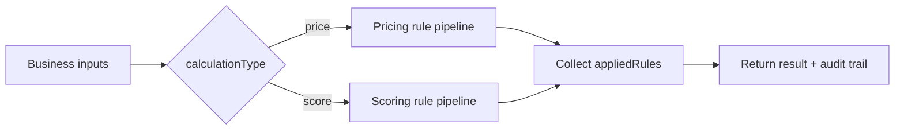
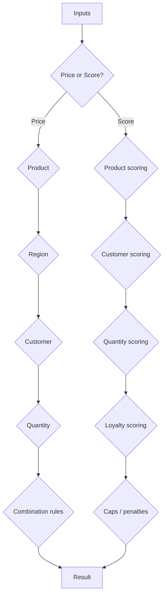

# Business Rules Calculator

## Description

**Business Rules Calculator** is the earlier combined design from this set. It exposes one operation that can run either a **price calculation** or a **score calculation**, selected by the `calculationType` input.

It demonstrates how a flow can call a reusable function instead of maintaining hundreds of Conditions such as:

`product A + region B + customer type C + quantity threshold + priority ...`

> **Design status:** This was later simplified into the single-purpose **Pricing Calculator**. Keep this version if the combined price/score example is useful; prefer the Pricing Calculator when you want a smaller, easier-to-explain demo.

## Connector summary

| Detail | Value |
|---|---|
| Connector | Business Rules Calculator |
| Host | `api.local` |
| Base path | `/` |
| Operation | `POST /calculate` |
| Operation ID | `CalculateBusinessRules` |
| Calculation types | `price`, `score` |
| Main outputs | `result`, `originalValue`, `adjustment`, `appliedRules` |
| Backend call required | No |

## How the connector works



## What the Power Automate alternative can become



## Swagger 2.0

```yaml
swagger: '2.0'

info:
  title: Business Rules Calculator
  description: Calculates pricing or scoring using reusable business rules implemented in C#.
  version: '1.0'

host: api.local

basePath: /

schemes:
  - https

consumes:
  - application/json

produces:
  - application/json

paths:
  /calculate:
    post:
      summary: Calculate Price or Score
      description: Applies business rules to calculate either a price or a score.
      operationId: CalculateBusinessRules

      parameters:
        - name: body
          in: body
          required: true
          schema:
            type: object
            required:
              - calculationType
              - product
              - region
              - customerType
            properties:
              calculationType:
                type: string
                description: Select whether to calculate a price or a score.
                x-ms-summary: Calculation Type
                enum:
                  - price
                  - score

              product:
                type: string
                description: Product being purchased or assessed.
                x-ms-summary: Product
                enum:
                  - Standard
                  - Professional
                  - Enterprise

              region:
                type: string
                description: Customer region.
                x-ms-summary: Region
                enum:
                  - UK
                  - Europe
                  - NorthAmerica
                  - AsiaPacific

              customerType:
                type: string
                description: Type of customer.
                x-ms-summary: Customer Type
                enum:
                  - Standard
                  - Partner
                  - Government
                  - Education

              quantity:
                type: integer
                format: int32
                description: Number of units.
                x-ms-summary: Quantity
                default: 1

              basePrice:
                type: number
                format: double
                description: Base price per unit before adjustments.
                x-ms-summary: Base Price

              loyaltyYears:
                type: integer
                format: int32
                description: Number of years the customer has been active.
                x-ms-summary: Loyalty Years
                default: 0

              priority:
                type: string
                description: Delivery or service priority.
                x-ms-summary: Priority
                enum:
                  - Standard
                  - Priority
                  - Urgent

      responses:
        '200':
          description: Calculation completed successfully.
          schema:
            type: object
            properties:
              success:
                type: boolean
              calculationType:
                type: string
              result:
                type: number
                format: double
              originalValue:
                type: number
                format: double
              adjustment:
                type: number
                format: double
              appliedRules:
                type: array
                items:
                  type: string
              error:
                type: string
                x-nullable: true

        '400':
          description: Invalid request.
          schema:
            type: object
            properties:
              success:
                type: boolean
              error:
                type: string

definitions: {}
```

## C# custom connector code

```csharp
public class Script : ScriptBase
{
    public override async Task<HttpResponseMessage> ExecuteAsync()
    {
        return await Calculate();
    }

    private async Task<HttpResponseMessage> Calculate()
    {
        var requestBody =
            await this.Context.Request.Content.ReadAsStringAsync();

        JObject input;

        try
        {
            input = JObject.Parse(requestBody);
        }
        catch
        {
            return CreateBadRequestResponse(
                "The request body must contain valid JSON."
            );
        }

        var calculationType = input["calculationType"]?.ToString();
        var product = input["product"]?.ToString();
        var region = input["region"]?.ToString();
        var customerType = input["customerType"]?.ToString();
        var priority = input["priority"]?.ToString() ?? "Standard";

        int quantity =
            input["quantity"]?.Value<int?>() ?? 1;

        decimal basePrice =
            input["basePrice"]?.Value<decimal?>() ?? 0;

        int loyaltyYears =
            input["loyaltyYears"]?.Value<int?>() ?? 0;

        if (string.IsNullOrWhiteSpace(calculationType))
            return CreateBadRequestResponse("The 'calculationType' property is required.");

        if (string.IsNullOrWhiteSpace(product))
            return CreateBadRequestResponse("The 'product' property is required.");

        if (string.IsNullOrWhiteSpace(region))
            return CreateBadRequestResponse("The 'region' property is required.");

        if (string.IsNullOrWhiteSpace(customerType))
            return CreateBadRequestResponse("The 'customerType' property is required.");

        if (quantity < 1)
            return CreateBadRequestResponse("Quantity must be greater than zero.");

        try
        {
            if (calculationType == "price")
            {
                return CalculatePrice(
                    product,
                    region,
                    customerType,
                    quantity,
                    basePrice,
                    loyaltyYears,
                    priority
                );
            }

            if (calculationType == "score")
            {
                return CalculateScore(
                    product,
                    region,
                    customerType,
                    quantity,
                    loyaltyYears,
                    priority
                );
            }

            return CreateBadRequestResponse(
                "Calculation type must be 'price' or 'score'."
            );
        }
        catch (Exception ex)
        {
            var result = new JObject
            {
                ["success"] = false,
                ["error"] = ex.Message
            };

            return CreateJsonResponse(HttpStatusCode.OK, result);
        }
    }

    private HttpResponseMessage CalculatePrice(
        string product,
        string region,
        string customerType,
        int quantity,
        decimal basePrice,
        int loyaltyYears,
        string priority)
    {
        var appliedRules = new JArray();

        decimal unitPrice = basePrice;

        if (unitPrice <= 0)
        {
            switch (product)
            {
                case "Standard":
                    unitPrice = 100m;
                    break;
                case "Professional":
                    unitPrice = 250m;
                    break;
                case "Enterprise":
                    unitPrice = 500m;
                    break;
                default:
                    unitPrice = 100m;
                    break;
            }

            appliedRules.Add("Default product price applied");
        }

        decimal originalPrice = unitPrice * quantity;
        decimal price = originalPrice;

        if (product == "Enterprise")
        {
            price *= 1.10m;
            appliedRules.Add("Enterprise product: 10% premium");
        }

        if (region == "Europe")
        {
            price *= 1.05m;
            appliedRules.Add("Europe region: 5% regional adjustment");
        }

        if (region == "NorthAmerica")
        {
            price *= 1.08m;
            appliedRules.Add("North America: 8% regional adjustment");
        }

        if (region == "AsiaPacific")
        {
            price *= 1.12m;
            appliedRules.Add("Asia Pacific: 12% regional adjustment");
        }

        if (customerType == "Partner")
        {
            price *= 0.85m;
            appliedRules.Add("Partner customer: 15% discount");
        }

        if (customerType == "Government")
        {
            price *= 0.90m;
            appliedRules.Add("Government customer: 10% discount");
        }

        if (customerType == "Education")
        {
            price *= 0.80m;
            appliedRules.Add("Education customer: 20% discount");
        }

        if (quantity >= 100)
        {
            price *= 0.80m;
            appliedRules.Add("100+ units: 20% volume discount");
        }
        else if (quantity >= 50)
        {
            price *= 0.85m;
            appliedRules.Add("50+ units: 15% volume discount");
        }
        else if (quantity >= 20)
        {
            price *= 0.90m;
            appliedRules.Add("20+ units: 10% volume discount");
        }
        else if (quantity >= 10)
        {
            price *= 0.95m;
            appliedRules.Add("10+ units: 5% volume discount");
        }

        if (loyaltyYears >= 5)
        {
            price *= 0.90m;
            appliedRules.Add("5+ years loyalty: 10% discount");
        }
        else if (loyaltyYears >= 3)
        {
            price *= 0.95m;
            appliedRules.Add("3+ years loyalty: 5% discount");
        }

        if (priority == "Priority")
        {
            price *= 1.10m;
            appliedRules.Add("Priority service: 10% surcharge");
        }

        if (priority == "Urgent")
        {
            price *= 1.25m;
            appliedRules.Add("Urgent service: 25% surcharge");
        }

        if (
            product == "Enterprise"
            &&
            region == "UK"
            &&
            customerType == "Partner")
        {
            price *= 0.95m;
            appliedRules.Add(
                "Enterprise UK Partner promotion: additional 5% discount"
            );
        }

        if (
            customerType == "Government"
            &&
            quantity >= 50)
        {
            price *= 0.95m;
            appliedRules.Add(
                "Government bulk purchase: additional 5% discount"
            );
        }

        if (
            product == "Enterprise"
            &&
            customerType == "Education"
            &&
            quantity >= 20)
        {
            price *= 0.90m;
            appliedRules.Add(
                "Enterprise education agreement: additional 10% discount"
            );
        }

        price = Math.Round(price, 2);
        decimal adjustment = price - originalPrice;

        var result = new JObject
        {
            ["success"] = true,
            ["calculationType"] = "price",
            ["result"] = price,
            ["originalValue"] = originalPrice,
            ["adjustment"] = adjustment,
            ["appliedRules"] = appliedRules,
            ["error"] = null
        };

        return CreateJsonResponse(HttpStatusCode.OK, result);
    }

    private HttpResponseMessage CalculateScore(
        string product,
        string region,
        string customerType,
        int quantity,
        int loyaltyYears,
        string priority)
    {
        var appliedRules = new JArray();

        decimal originalScore = 50m;
        decimal score = originalScore;

        if (product == "Professional")
        {
            score += 5;
            appliedRules.Add("Professional product: +5");
        }

        if (product == "Enterprise")
        {
            score += 15;
            appliedRules.Add("Enterprise product: +15");
        }

        if (customerType == "Partner")
        {
            score += 15;
            appliedRules.Add("Partner customer: +15");
        }

        if (customerType == "Government")
        {
            score += 10;
            appliedRules.Add("Government customer: +10");
        }

        if (customerType == "Education")
        {
            score += 5;
            appliedRules.Add("Education customer: +5");
        }

        if (quantity >= 100)
        {
            score += 20;
            appliedRules.Add("100+ units: +20");
        }
        else if (quantity >= 50)
        {
            score += 15;
            appliedRules.Add("50+ units: +15");
        }
        else if (quantity >= 20)
        {
            score += 10;
            appliedRules.Add("20+ units: +10");
        }

        if (loyaltyYears >= 5)
        {
            score += 15;
            appliedRules.Add("5+ years loyalty: +15");
        }
        else if (loyaltyYears >= 3)
        {
            score += 10;
            appliedRules.Add("3+ years loyalty: +10");
        }
        else if (loyaltyYears >= 1)
        {
            score += 5;
            appliedRules.Add("Existing customer: +5");
        }

        if (
            product == "Enterprise"
            &&
            customerType == "Partner")
        {
            score += 10;
            appliedRules.Add("Enterprise Partner combination: +10");
        }

        if (
            customerType == "Government"
            &&
            region == "UK")
        {
            score += 5;
            appliedRules.Add("UK Government customer: +5");
        }

        if (priority == "Urgent")
        {
            score -= 10;
            appliedRules.Add("Urgent request: -10");
        }

        if (score > 100)
        {
            score = 100;
            appliedRules.Add("Maximum score capped at 100");
        }

        if (score < 0)
        {
            score = 0;
            appliedRules.Add("Minimum score capped at 0");
        }

        decimal adjustment = score - originalScore;

        var result = new JObject
        {
            ["success"] = true,
            ["calculationType"] = "score",
            ["result"] = score,
            ["originalValue"] = originalScore,
            ["adjustment"] = adjustment,
            ["appliedRules"] = appliedRules,
            ["error"] = null
        };

        return CreateJsonResponse(HttpStatusCode.OK, result);
    }

    private HttpResponseMessage CreateBadRequestResponse(string message)
    {
        var result = new JObject
        {
            ["success"] = false,
            ["error"] = message
        };

        return CreateJsonResponse(HttpStatusCode.BadRequest, result);
    }

    private HttpResponseMessage CreateJsonResponse(
        HttpStatusCode statusCode,
        JObject body)
    {
        var response = new HttpResponseMessage(statusCode);
        response.Content = CreateJsonContent(body.ToString());
        return response;
    }
}
```

## Sample payload — price

```json
{
  "calculationType": "price",
  "product": "Enterprise",
  "region": "UK",
  "customerType": "Partner",
  "quantity": 25,
  "basePrice": 100,
  "loyaltyYears": 4,
  "priority": "Standard"
}
```

### Expected result

```json
{
  "success": true,
  "calculationType": "price",
  "result": 1898.63,
  "originalValue": 2500,
  "adjustment": -601.37,
  "appliedRules": [
    "Enterprise product: 10% premium",
    "Partner customer: 15% discount",
    "20+ units: 10% volume discount",
    "3+ years loyalty: 5% discount",
    "Enterprise UK Partner promotion: additional 5% discount"
  ],
  "error": null
}
```

## Sample payload — score

```json
{
  "calculationType": "score",
  "product": "Enterprise",
  "region": "UK",
  "customerType": "Partner",
  "quantity": 25,
  "basePrice": 100,
  "loyaltyYears": 4,
  "priority": "Standard"
}
```

### Expected result

```json
{
  "success": true,
  "calculationType": "score",
  "result": 100,
  "originalValue": 50,
  "adjustment": 50,
  "appliedRules": [
    "Enterprise product: +15",
    "Partner customer: +15",
    "20+ units: +10",
    "3+ years loyalty: +10",
    "Enterprise Partner combination: +10",
    "Maximum score capped at 100"
  ],
  "error": null
}
```

## When to use this version

Use the combined design when:

- the inputs are largely shared,
- pricing and scoring represent closely related rules,
- a single connector action is desirable.

Prefer separate connectors/operations when:

- ownership differs,
- rule lifecycles differ,
- consumers need clearer contracts,
- you want a simpler teaching/demo example.


## Power Platform implementation note

These examples are designed for the **Custom Code** feature in a Microsoft Power Platform custom connector.

- Host used in the examples: `api.local`
- Protocol: `HTTPS`
- Definition format: Swagger / OpenAPI 2.0
- Custom code entry point: `public class Script : ScriptBase`
- The script returns its own `HttpResponseMessage`; it does **not** call `Context.SendAsync()`.
- When custom code is enabled for the operation, Microsoft documents that the custom code takes precedence over the codeless definition, so the request does not need to be forwarded to the backend.
- Microsoft currently documents .NET Standard 2.0 and a restricted set of supported namespaces for custom connector code.
- Platform limits can change. Test payload size and execution time in the target tenant before using these patterns for high-volume production workloads.

> `api.local` is intentionally used as a placeholder host for these demonstrations. If your governance or import tooling requires a resolvable host, replace it with an HTTPS endpoint you control even when the custom code returns without forwarding the request.

### Official Microsoft references

- Write code in a custom connector: https://learn.microsoft.com/en-us/connectors/custom-connectors/write-code
- Create a custom connector from scratch: https://learn.microsoft.com/en-us/connectors/custom-connectors/define-blank
- Custom connector FAQ: https://learn.microsoft.com/en-in/connectors/custom-connectors/faq
