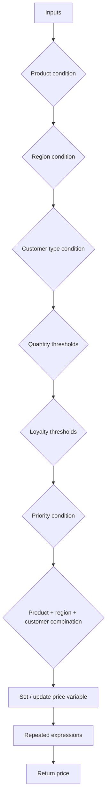
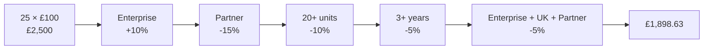

# Pricing Calculator

## Description

**Pricing Calculator** centralises reusable pricing rules in C# so that a Power Automate flow can call a single `CalculatePrice` action rather than maintaining a large tree of conditions, expressions, variables, and duplicated pricing logic.

The example includes product, region, customer type, quantity, loyalty, priority, and combination rules. It also returns an audit trail showing exactly which pricing rules fired.

## Connector summary

| Detail | Value |
|---|---|
| Connector | Pricing Calculator |
| Host | `api.local` |
| Base path | `/` |
| Operation | `POST /calculate` |
| Operation ID | `CalculatePrice` |
| Main output | `calculatedPrice` |
| Audit output | `appliedRules` |
| Backend call required | No |

## How the connector works

```mermaid
flowchart LR
    A[Pricing inputs] --> B[Start with basePrice × quantity]
    B --> C[Apply product rules]
    C --> D[Apply region rules]
    D --> E[Apply customer rules]
    E --> F[Apply volume rules]
    F --> G[Apply loyalty rules]
    G --> H[Apply priority rules]
    H --> I[Apply combination rules]
    I --> J[Round result]
    J --> K[Return price + appliedRules]
```



## What the Power Automate alternative can become



As rules grow, the logic typically spreads across nested Conditions, Switch actions, variables, and repeated formulas.

## Swagger 2.0

```yaml
swagger: '2.0'

info:
  title: Pricing Calculator
  description: Calculates a price using reusable business rules implemented in C#.
  version: '1.0'

host: api.local

basePath: /

schemes:
  - https

consumes:
  - application/json

produces:
  - application/json

paths:
  /calculate:
    post:
      summary: Calculate Price
      description: Calculates a price based on product, region, customer type and other pricing rules.
      operationId: CalculatePrice

      parameters:
        - name: body
          in: body
          required: true
          schema:
            type: object
            required:
              - product
              - region
              - customerType
              - quantity
              - basePrice
            properties:
              product:
                type: string
                description: Product being purchased.
                x-ms-summary: Product
                enum:
                  - Standard
                  - Professional
                  - Enterprise

              region:
                type: string
                description: Customer region.
                x-ms-summary: Region
                enum:
                  - UK
                  - Europe
                  - NorthAmerica
                  - AsiaPacific

              customerType:
                type: string
                description: Type of customer.
                x-ms-summary: Customer Type
                enum:
                  - Standard
                  - Partner
                  - Government
                  - Education

              quantity:
                type: integer
                format: int32
                description: Number of units being purchased.
                x-ms-summary: Quantity
                default: 1

              basePrice:
                type: number
                format: double
                description: Base price per unit.
                x-ms-summary: Base Price

              loyaltyYears:
                type: integer
                format: int32
                description: Number of years the customer has been active.
                x-ms-summary: Loyalty Years
                default: 0

              priority:
                type: string
                description: Service or delivery priority.
                x-ms-summary: Priority
                enum:
                  - Standard
                  - Priority
                  - Urgent
                default: Standard

      responses:
        '200':
          description: Price calculated successfully.
          schema:
            type: object
            properties:
              success:
                type: boolean
              originalPrice:
                type: number
                format: double
              calculatedPrice:
                type: number
                format: double
              adjustment:
                type: number
                format: double
              appliedRules:
                type: array
                items:
                  type: string
              error:
                type: string
                x-nullable: true

        '400':
          description: Invalid request.
          schema:
            type: object
            properties:
              success:
                type: boolean
              error:
                type: string

definitions: {}
```

## C# custom connector code

```csharp
public class Script : ScriptBase
{
    public override async Task<HttpResponseMessage> ExecuteAsync()
    {
        return await CalculatePrice();
    }

    private async Task<HttpResponseMessage> CalculatePrice()
    {
        var requestBody =
            await this.Context.Request.Content.ReadAsStringAsync();

        JObject input;

        try
        {
            input = JObject.Parse(requestBody);
        }
        catch
        {
            return CreateBadRequestResponse(
                "The request body must contain valid JSON."
            );
        }

        var product = input["product"]?.ToString();
        var region = input["region"]?.ToString();
        var customerType = input["customerType"]?.ToString();
        var priority = input["priority"]?.ToString() ?? "Standard";

        int quantity =
            input["quantity"]?.Value<int?>() ?? 1;

        decimal basePrice =
            input["basePrice"]?.Value<decimal?>() ?? 0;

        int loyaltyYears =
            input["loyaltyYears"]?.Value<int?>() ?? 0;

        if (string.IsNullOrWhiteSpace(product))
        {
            return CreateBadRequestResponse(
                "The 'product' property is required."
            );
        }

        if (string.IsNullOrWhiteSpace(region))
        {
            return CreateBadRequestResponse(
                "The 'region' property is required."
            );
        }

        if (string.IsNullOrWhiteSpace(customerType))
        {
            return CreateBadRequestResponse(
                "The 'customerType' property is required."
            );
        }

        if (quantity < 1)
        {
            return CreateBadRequestResponse(
                "Quantity must be greater than zero."
            );
        }

        if (basePrice < 0)
        {
            return CreateBadRequestResponse(
                "Base price cannot be negative."
            );
        }

        try
        {
            var appliedRules = new JArray();

            decimal originalPrice = basePrice * quantity;
            decimal calculatedPrice = originalPrice;

            if (product == "Professional")
            {
                calculatedPrice *= 1.05m;
                appliedRules.Add("Professional product: 5% premium");
            }

            if (product == "Enterprise")
            {
                calculatedPrice *= 1.10m;
                appliedRules.Add("Enterprise product: 10% premium");
            }

            if (region == "Europe")
            {
                calculatedPrice *= 1.05m;
                appliedRules.Add("Europe region: 5% adjustment");
            }

            if (region == "NorthAmerica")
            {
                calculatedPrice *= 1.08m;
                appliedRules.Add("North America region: 8% adjustment");
            }

            if (region == "AsiaPacific")
            {
                calculatedPrice *= 1.12m;
                appliedRules.Add("Asia Pacific region: 12% adjustment");
            }

            if (customerType == "Partner")
            {
                calculatedPrice *= 0.85m;
                appliedRules.Add("Partner customer: 15% discount");
            }

            if (customerType == "Government")
            {
                calculatedPrice *= 0.90m;
                appliedRules.Add("Government customer: 10% discount");
            }

            if (customerType == "Education")
            {
                calculatedPrice *= 0.80m;
                appliedRules.Add("Education customer: 20% discount");
            }

            if (quantity >= 100)
            {
                calculatedPrice *= 0.80m;
                appliedRules.Add("100+ units: 20% volume discount");
            }
            else if (quantity >= 50)
            {
                calculatedPrice *= 0.85m;
                appliedRules.Add("50+ units: 15% volume discount");
            }
            else if (quantity >= 20)
            {
                calculatedPrice *= 0.90m;
                appliedRules.Add("20+ units: 10% volume discount");
            }
            else if (quantity >= 10)
            {
                calculatedPrice *= 0.95m;
                appliedRules.Add("10+ units: 5% volume discount");
            }

            if (loyaltyYears >= 5)
            {
                calculatedPrice *= 0.90m;
                appliedRules.Add("5+ years loyalty: 10% discount");
            }
            else if (loyaltyYears >= 3)
            {
                calculatedPrice *= 0.95m;
                appliedRules.Add("3+ years loyalty: 5% discount");
            }

            if (priority == "Priority")
            {
                calculatedPrice *= 1.10m;
                appliedRules.Add("Priority service: 10% surcharge");
            }

            if (priority == "Urgent")
            {
                calculatedPrice *= 1.25m;
                appliedRules.Add("Urgent service: 25% surcharge");
            }

            if (
                product == "Enterprise"
                &&
                region == "UK"
                &&
                customerType == "Partner")
            {
                calculatedPrice *= 0.95m;
                appliedRules.Add(
                    "Enterprise UK Partner: additional 5% discount"
                );
            }

            if (
                customerType == "Government"
                &&
                quantity >= 50)
            {
                calculatedPrice *= 0.95m;
                appliedRules.Add(
                    "Government bulk purchase: additional 5% discount"
                );
            }

            if (
                product == "Enterprise"
                &&
                customerType == "Education"
                &&
                quantity >= 20)
            {
                calculatedPrice *= 0.90m;
                appliedRules.Add(
                    "Enterprise Education agreement: additional 10% discount"
                );
            }

            calculatedPrice = Math.Round(calculatedPrice, 2);

            decimal adjustment =
                calculatedPrice - originalPrice;

            var result = new JObject
            {
                ["success"] = true,
                ["originalPrice"] = originalPrice,
                ["calculatedPrice"] = calculatedPrice,
                ["adjustment"] = adjustment,
                ["appliedRules"] = appliedRules,
                ["error"] = null
            };

            return CreateJsonResponse(HttpStatusCode.OK, result);
        }
        catch (Exception ex)
        {
            var result = new JObject
            {
                ["success"] = false,
                ["error"] = ex.Message
            };

            return CreateJsonResponse(HttpStatusCode.OK, result);
        }
    }

    private HttpResponseMessage CreateBadRequestResponse(string message)
    {
        var result = new JObject
        {
            ["success"] = false,
            ["error"] = message
        };

        return CreateJsonResponse(HttpStatusCode.BadRequest, result);
    }

    private HttpResponseMessage CreateJsonResponse(
        HttpStatusCode statusCode,
        JObject body)
    {
        var response = new HttpResponseMessage(statusCode);
        response.Content = CreateJsonContent(body.ToString());
        return response;
    }
}
```

## Sample payload

```json
{
  "product": "Enterprise",
  "region": "UK",
  "customerType": "Partner",
  "quantity": 25,
  "basePrice": 100,
  "loyaltyYears": 4,
  "priority": "Standard"
}
```

## Calculation pipeline for this example



## Expected result

```json
{
  "success": true,
  "originalPrice": 2500,
  "calculatedPrice": 1898.63,
  "adjustment": -601.37,
  "appliedRules": [
    "Enterprise product: 10% premium",
    "Partner customer: 15% discount",
    "20+ units: 10% volume discount",
    "3+ years loyalty: 5% discount",
    "Enterprise UK Partner: additional 5% discount"
  ],
  "error": null
}
```

## Why `appliedRules` matters

Returning the rule audit trail is useful for:

- troubleshooting,
- explaining a price to a user,
- testing rule changes,
- recording calculation provenance,
- making the connector less of a "black box".

## Production considerations

For a larger pricing engine, consider separating:

- rule definitions,
- rule evaluation,
- product/reference data,
- versioning/effective dates,
- audit metadata.

Hard-coded rules are excellent for a demo or stable logic, but a frequently changing pricing model may be better served by Dataverse configuration records or a dedicated rules service.


## Power Platform implementation note

These examples are designed for the **Custom Code** feature in a Microsoft Power Platform custom connector.

- Host used in the examples: `api.local`
- Protocol: `HTTPS`
- Definition format: Swagger / OpenAPI 2.0
- Custom code entry point: `public class Script : ScriptBase`
- The script returns its own `HttpResponseMessage`; it does **not** call `Context.SendAsync()`.
- When custom code is enabled for the operation, Microsoft documents that the custom code takes precedence over the codeless definition, so the request does not need to be forwarded to the backend.
- Microsoft currently documents .NET Standard 2.0 and a restricted set of supported namespaces for custom connector code.
- Platform limits can change. Test payload size and execution time in the target tenant before using these patterns for high-volume production workloads.

> `api.local` is intentionally used as a placeholder host for these demonstrations. If your governance or import tooling requires a resolvable host, replace it with an HTTPS endpoint you control even when the custom code returns without forwarding the request.

### Official Microsoft references

- Write code in a custom connector: https://learn.microsoft.com/en-us/connectors/custom-connectors/write-code
- Create a custom connector from scratch: https://learn.microsoft.com/en-us/connectors/custom-connectors/define-blank
- Custom connector FAQ: https://learn.microsoft.com/en-in/connectors/custom-connectors/faq
