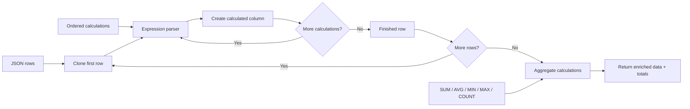
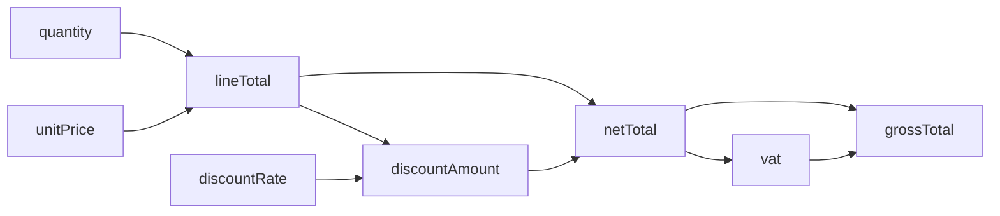
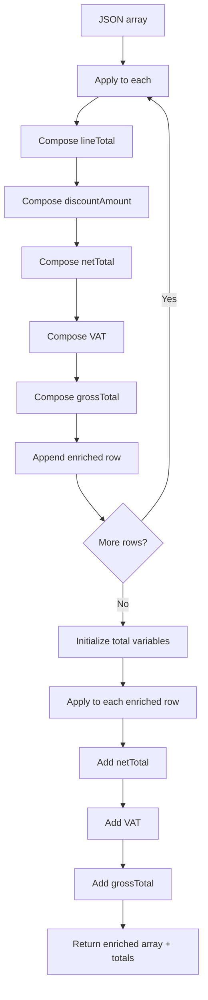

# JSON Calculation Engine

## Description

**JSON Calculation Engine** accepts a JSON table plus calculation rules supplied as data.

Each row calculation has the form:

```text
outputColumn = expression
```

Calculations run **in order**, so a newly created output column can be referenced by the next calculation.

After all row calculations are complete, optional aggregate calculations can calculate values such as:

```text
totalNet = SUM(netTotal)
totalVat = SUM(vat)
grandTotal = SUM(grossTotal)
```

This turns one custom connector action into a small, controlled calculation pipeline without allowing arbitrary C# or JavaScript execution.

## Connector summary

| Detail | Value |
|---|---|
| Connector | JSON Calculation Engine |
| Host | `api.local` |
| Base path | `/` |
| Operation | `POST /calculate` |
| Operation ID | `CalculateJsonData` |
| Input data | Array of JSON objects |
| Row calculations | Ordered array of `column = expression` strings |
| Aggregate calculations | `SUM`, `AVG`, `MIN`, `MAX`, `COUNT` |
| Row operators | `+`, `-`, `*`, `/`, parentheses |
| Can reuse calculated columns | Yes |
| Backend call required | No |

## How the connector works



## Calculation dependency pipeline

For:

```text
lineTotal = quantity * unitPrice
discountAmount = lineTotal * discountRate
netTotal = lineTotal - discountAmount
vat = netTotal * 0.20
grossTotal = netTotal + vat
```

the dependency chain is:



## What the Power Automate alternative can become



The connector makes both the **schema** and the **calculation pipeline** data-driven.

## Example request

```json
{
  "data": [
    {
      "product": "Laptop",
      "quantity": 2,
      "unitPrice": 750,
      "discountRate": 0.1
    },
    {
      "product": "Monitor",
      "quantity": 4,
      "unitPrice": 200,
      "discountRate": 0.05
    },
    {
      "product": "Keyboard",
      "quantity": 5,
      "unitPrice": 50,
      "discountRate": 0
    }
  ],
  "calculations": [
    "lineTotal = quantity * unitPrice",
    "discountAmount = lineTotal * discountRate",
    "netTotal = lineTotal - discountAmount",
    "vat = netTotal * 0.20",
    "grossTotal = netTotal + vat"
  ],
  "totals": [
    "totalNet = SUM(netTotal)",
    "totalVat = SUM(vat)",
    "grandTotal = SUM(grossTotal)"
  ]
}
```

## Swagger 2.0

```yaml
swagger: '2.0'

info:
  title: JSON Calculation Engine
  description: Performs sequential calculations against rows in a JSON array and calculates aggregate totals.
  version: '1.0'

host: api.local

basePath: /

schemes:
  - https

consumes:
  - application/json

produces:
  - application/json

paths:
  /calculate:
    post:
      summary: Calculate JSON Data
      description: Applies sequential calculations to JSON records and optionally calculates aggregate values.
      operationId: CalculateJsonData
      x-ms-visibility: important

      parameters:
        - name: body
          in: body
          required: true
          schema:
            type: object
            required:
              - data
              - calculations
            properties:
              data:
                type: array
                description: JSON table containing the source data.
                x-ms-summary: Data
                items:
                  type: object
                  additionalProperties: {}

              calculations:
                type: array
                description: Calculations to perform against every row. Calculations are executed in order and may reference columns created by previous calculations.
                x-ms-summary: Row Calculations
                items:
                  type: string

              totals:
                type: array
                description: Optional aggregate calculations performed after all row calculations.
                x-ms-summary: Aggregate Calculations
                items:
                  type: string

      responses:
        '200':
          description: Calculations completed successfully.
          schema:
            type: object
            properties:
              success:
                type: boolean
              rowCount:
                type: integer
                format: int32
              data:
                type: array
                items:
                  type: object
                  additionalProperties: {}
              totals:
                type: object
                additionalProperties: {}
              error:
                type: string
                x-nullable: true

        '400':
          description: Invalid request.
          schema:
            type: object
            properties:
              success:
                type: boolean
              error:
                type: string

definitions: {}
```

## C# custom connector code

```csharp
public class Script : ScriptBase
{
    public override async Task<HttpResponseMessage> ExecuteAsync()
    {
        return await Calculate();
    }

    private async Task<HttpResponseMessage> Calculate()
    {
        var requestBody =
            await this.Context.Request.Content.ReadAsStringAsync();

        JObject input;

        try
        {
            input = JObject.Parse(requestBody);
        }
        catch
        {
            return CreateBadRequestResponse(
                "The request body must contain valid JSON."
            );
        }

        var data = input["data"] as JArray;
        var calculations = input["calculations"] as JArray;
        var totalCalculations = input["totals"] as JArray;

        if (data == null)
        {
            return CreateBadRequestResponse(
                "The 'data' property must contain a JSON array."
            );
        }

        if (calculations == null)
        {
            return CreateBadRequestResponse(
                "The 'calculations' property must contain an array."
            );
        }

        try
        {
            var outputData = new JArray();

            for (int rowIndex = 0;
                 rowIndex < data.Count;
                 rowIndex++)
            {
                var sourceRow = data[rowIndex] as JObject;

                if (sourceRow == null)
                {
                    return CreateBadRequestResponse(
                        "Every item in 'data' must be a JSON object."
                    );
                }

                var row = (JObject)sourceRow.DeepClone();

                for (int calculationIndex = 0;
                     calculationIndex < calculations.Count;
                     calculationIndex++)
                {
                    var calculation =
                        calculations[calculationIndex]?.ToString();

                    if (string.IsNullOrWhiteSpace(calculation))
                    {
                        continue;
                    }

                    string outputColumn;
                    string expression;

                    ParseAssignment(
                        calculation,
                        out outputColumn,
                        out expression
                    );

                    try
                    {
                        var parser =
                            new ExpressionParser(
                                expression,
                                row
                            );

                        decimal result = parser.Parse();

                        row[outputColumn] = result;
                    }
                    catch (Exception ex)
                    {
                        throw new Exception(
                            "Error in row " +
                            (rowIndex + 1) +
                            ", calculation '" +
                            calculation +
                            "': " +
                            ex.Message
                        );
                    }
                }

                outputData.Add(row);
            }

            var totals = new JObject();

            if (totalCalculations != null)
            {
                for (int i = 0;
                     i < totalCalculations.Count;
                     i++)
                {
                    var calculation =
                        totalCalculations[i]?.ToString();

                    if (string.IsNullOrWhiteSpace(calculation))
                    {
                        continue;
                    }

                    string outputColumn;
                    string expression;

                    ParseAssignment(
                        calculation,
                        out outputColumn,
                        out expression
                    );

                    decimal result =
                        EvaluateAggregate(
                            expression,
                            outputData
                        );

                    totals[outputColumn] = result;
                }
            }

            var responseBody = new JObject
            {
                ["success"] = true,
                ["rowCount"] = outputData.Count,
                ["data"] = outputData,
                ["totals"] = totals,
                ["error"] = null
            };

            return CreateJsonResponse(
                HttpStatusCode.OK,
                responseBody
            );
        }
        catch (Exception ex)
        {
            var responseBody = new JObject
            {
                ["success"] = false,
                ["error"] = ex.Message
            };

            return CreateJsonResponse(
                HttpStatusCode.OK,
                responseBody
            );
        }
    }

    private void ParseAssignment(
        string calculation,
        out string outputColumn,
        out string expression)
    {
        int equalsIndex = calculation.IndexOf('=');

        if (equalsIndex <= 0)
        {
            throw new Exception(
                "Calculation must use the format 'outputColumn = expression'."
            );
        }

        outputColumn =
            calculation.Substring(0, equalsIndex).Trim();

        expression =
            calculation.Substring(equalsIndex + 1).Trim();

        if (
            outputColumn.StartsWith("[")
            &&
            outputColumn.EndsWith("]"))
        {
            outputColumn =
                outputColumn.Substring(
                    1,
                    outputColumn.Length - 2
                );
        }

        if (string.IsNullOrWhiteSpace(outputColumn))
        {
            throw new Exception(
                "The output column name cannot be empty."
            );
        }

        if (string.IsNullOrWhiteSpace(expression))
        {
            throw new Exception(
                "The calculation expression cannot be empty."
            );
        }
    }

    private decimal EvaluateAggregate(
        string expression,
        JArray data)
    {
        var match =
            Regex.Match(
                expression,
                @"^\s*(SUM|AVG|MIN|MAX|COUNT)\s*\(\s*(.+?)\s*\)\s*$",
                RegexOptions.IgnoreCase
            );

        if (!match.Success)
        {
            throw new Exception(
                "Aggregate expressions must use SUM(), AVG(), MIN(), MAX() or COUNT()."
            );
        }

        string function =
            match.Groups[1].Value.ToUpperInvariant();

        string column =
            match.Groups[2].Value.Trim();

        if (
            column.StartsWith("[")
            &&
            column.EndsWith("]"))
        {
            column =
                column.Substring(
                    1,
                    column.Length - 2
                );
        }

        if (function == "COUNT")
        {
            decimal count = 0;

            foreach (var item in data)
            {
                var row = item as JObject;
                var token = GetPropertyValue(row, column);

                if (
                    token != null
                    &&
                    token.Type != JTokenType.Null)
                {
                    count++;
                }
            }

            return count;
        }

        decimal total = 0;
        decimal minimum = 0;
        decimal maximum = 0;
        int countValues = 0;

        foreach (var item in data)
        {
            var row = item as JObject;
            var token = GetPropertyValue(row, column);

            if (token == null)
            {
                throw new Exception(
                    "Column '" + column + "' was not found."
                );
            }

            decimal value =
                ConvertToDecimal(token, column);

            if (countValues == 0)
            {
                minimum = value;
                maximum = value;
            }
            else
            {
                if (value < minimum)
                    minimum = value;

                if (value > maximum)
                    maximum = value;
            }

            total += value;
            countValues++;
        }

        if (function == "SUM")
            return total;

        if (function == "AVG")
            return countValues == 0 ? 0 : total / countValues;

        if (function == "MIN")
            return countValues == 0 ? 0 : minimum;

        if (function == "MAX")
            return countValues == 0 ? 0 : maximum;

        throw new Exception(
            "Unsupported aggregate function."
        );
    }

    private static JToken GetPropertyValue(
        JObject row,
        string propertyName)
    {
        if (row == null)
        {
            return null;
        }

        foreach (var property in row.Properties())
        {
            if (
                string.Equals(
                    property.Name,
                    propertyName,
                    StringComparison.OrdinalIgnoreCase
                ))
            {
                return property.Value;
            }
        }

        return null;
    }

    private static decimal ConvertToDecimal(
        JToken token,
        string column)
    {
        if (
            token == null
            ||
            token.Type == JTokenType.Null)
        {
            throw new Exception(
                "Column '" +
                column +
                "' contains a null value."
            );
        }

        decimal value;

        if (
            decimal.TryParse(
                token.ToString(),
                System.Globalization.NumberStyles.Any,
                System.Globalization.CultureInfo.InvariantCulture,
                out value
            ))
        {
            return value;
        }

        throw new Exception(
            "Column '" +
            column +
            "' must contain a numeric value."
        );
    }

    private class ExpressionParser
    {
        private readonly string expression;
        private readonly JObject row;
        private int position;

        public ExpressionParser(
            string expression,
            JObject row)
        {
            this.expression = expression;
            this.row = row;
            this.position = 0;
        }

        public decimal Parse()
        {
            decimal value = ParseExpression();

            SkipWhitespace();

            if (position != expression.Length)
            {
                throw new Exception(
                    "Unexpected character at position " +
                    position +
                    "."
                );
            }

            return value;
        }

        private decimal ParseExpression()
        {
            decimal value = ParseTerm();

            while (true)
            {
                SkipWhitespace();

                if (Match('+'))
                {
                    value += ParseTerm();
                }
                else if (Match('-'))
                {
                    value -= ParseTerm();
                }
                else
                {
                    break;
                }
            }

            return value;
        }

        private decimal ParseTerm()
        {
            decimal value = ParseFactor();

            while (true)
            {
                SkipWhitespace();

                if (Match('*'))
                {
                    value *= ParseFactor();
                }
                else if (Match('/'))
                {
                    decimal divisor = ParseFactor();

                    if (divisor == 0)
                    {
                        throw new Exception(
                            "Division by zero."
                        );
                    }

                    value /= divisor;
                }
                else
                {
                    break;
                }
            }

            return value;
        }

        private decimal ParseFactor()
        {
            SkipWhitespace();

            if (Match('+'))
            {
                return ParseFactor();
            }

            if (Match('-'))
            {
                return -ParseFactor();
            }

            if (Match('('))
            {
                decimal value = ParseExpression();

                SkipWhitespace();

                if (!Match(')'))
                {
                    throw new Exception(
                        "Missing closing ')'."
                    );
                }

                return value;
            }

            if (position >= expression.Length)
            {
                throw new Exception(
                    "Unexpected end of expression."
                );
            }

            char current = expression[position];

            if (
                char.IsDigit(current)
                ||
                current == '.')
            {
                return ParseNumber();
            }

            if (
                char.IsLetter(current)
                ||
                current == '_'
                ||
                current == '[')
            {
                string column = ParseIdentifier();

                var token =
                    GetPropertyValue(
                        row,
                        column
                    );

                if (token == null)
                {
                    throw new Exception(
                        "Column '" +
                        column +
                        "' was not found."
                    );
                }

                return ConvertToDecimal(
                    token,
                    column
                );
            }

            throw new Exception(
                "Unexpected character '" +
                current +
                "'."
            );
        }

        private decimal ParseNumber()
        {
            int start = position;

            while (
                position < expression.Length
                &&
                (
                    char.IsDigit(expression[position])
                    ||
                    expression[position] == '.'
                ))
            {
                position++;
            }

            string number =
                expression.Substring(
                    start,
                    position - start
                );

            decimal value;

            if (
                !decimal.TryParse(
                    number,
                    System.Globalization.NumberStyles.Any,
                    System.Globalization.CultureInfo.InvariantCulture,
                    out value
                ))
            {
                throw new Exception(
                    "Invalid number '" +
                    number +
                    "'."
                );
            }

            return value;
        }

        private string ParseIdentifier()
        {
            if (expression[position] == '[')
            {
                position++;

                int start = position;

                while (
                    position < expression.Length
                    &&
                    expression[position] != ']')
                {
                    position++;
                }

                if (position >= expression.Length)
                {
                    throw new Exception(
                        "Missing closing ']' in column name."
                    );
                }

                string name =
                    expression.Substring(
                        start,
                        position - start
                    );

                position++;

                return name.Trim();
            }

            int identifierStart = position;

            while (
                position < expression.Length
                &&
                (
                    char.IsLetterOrDigit(expression[position])
                    ||
                    expression[position] == '_'
                ))
            {
                position++;
            }

            return expression.Substring(
                identifierStart,
                position - identifierStart
            );
        }

        private bool Match(char character)
        {
            if (
                position < expression.Length
                &&
                expression[position] == character)
            {
                position++;
                return true;
            }

            return false;
        }

        private void SkipWhitespace()
        {
            while (
                position < expression.Length
                &&
                char.IsWhiteSpace(expression[position]))
            {
                position++;
            }
        }
    }

    private HttpResponseMessage CreateBadRequestResponse(string message)
    {
        var result = new JObject
        {
            ["success"] = false,
            ["error"] = message
        };

        return CreateJsonResponse(
            HttpStatusCode.BadRequest,
            result
        );
    }

    private HttpResponseMessage CreateJsonResponse(
        HttpStatusCode statusCode,
        JObject body)
    {
        var response =
            new HttpResponseMessage(statusCode);

        response.Content =
            CreateJsonContent(body.ToString());

        return response;
    }
}
```

## Expected result

For the example request:

```json
{
  "success": true,
  "rowCount": 3,
  "data": [
    {
      "product": "Laptop",
      "quantity": 2,
      "unitPrice": 750,
      "discountRate": 0.1,
      "lineTotal": 1500,
      "discountAmount": 150,
      "netTotal": 1350,
      "vat": 270,
      "grossTotal": 1620
    },
    {
      "product": "Monitor",
      "quantity": 4,
      "unitPrice": 200,
      "discountRate": 0.05,
      "lineTotal": 800,
      "discountAmount": 40,
      "netTotal": 760,
      "vat": 152,
      "grossTotal": 912
    },
    {
      "product": "Keyboard",
      "quantity": 5,
      "unitPrice": 50,
      "discountRate": 0,
      "lineTotal": 250,
      "discountAmount": 0,
      "netTotal": 250,
      "vat": 50,
      "grossTotal": 300
    }
  ],
  "totals": {
    "totalNet": 2360,
    "totalVat": 472,
    "grandTotal": 2832
  },
  "error": null
}
```

## Supported expression language

### Row expressions

Supported:

```text
quantity * unitPrice
lineTotal - discountAmount
netTotal * 0.20
(price + charge) * quantity
-[adjustment]
[Unit Price] * quantity
```

Operators:

- `+`
- `-`
- `*`
- `/`
- parentheses
- unary `+` and `-`

Column names containing spaces can be wrapped in square brackets:

```text
[Line Total] = quantity * [Unit Price]
```

### Aggregate expressions

Supported:

```text
SUM(netTotal)
AVG(netTotal)
MIN(netTotal)
MAX(netTotal)
COUNT(netTotal)
```

## Why use a constrained expression language?

Do **not** evaluate caller-supplied arbitrary C# or JavaScript.

The parser intentionally accepts a small language containing only known numeric operations and column references. This:

- reduces the attack surface,
- makes behaviour predictable,
- allows expressions to be validated,
- prevents a flow maker from executing arbitrary code.

## Calculation ordering

Order is significant.

This works:

```text
lineTotal = quantity * unitPrice
discount = lineTotal * discountRate
netTotal = lineTotal - discount
```

This does not work if `netTotal` appears before `lineTotal` has been created.

## Dynamic schema note

The connector adds output columns dynamically. Consequently, Power Automate cannot know every possible output property at connector design time.

For downstream strongly typed dynamic content, use **Parse JSON** after the connector with the expected schema for that particular calculation definition.

## Potential extensions

A future version could safely add:

- `ROUND(value, places)`
- `ABS(value)`
- `CEILING(value)`
- `FLOOR(value)`
- row-level `MIN()` / `MAX()`
- constants supplied separately from row data
- conditional functions such as a constrained `IF(condition, trueValue, falseValue)`
- aggregate calculations that reference earlier aggregate outputs
- validation-only mode
- named calculation profiles stored in Dataverse


## Power Platform implementation note

These examples are designed for the **Custom Code** feature in a Microsoft Power Platform custom connector.

- Host used in the examples: `api.local`
- Protocol: `HTTPS`
- Definition format: Swagger / OpenAPI 2.0
- Custom code entry point: `public class Script : ScriptBase`
- The script returns its own `HttpResponseMessage`; it does **not** call `Context.SendAsync()`.
- When custom code is enabled for the operation, Microsoft documents that the custom code takes precedence over the codeless definition, so the request does not need to be forwarded to the backend.
- Microsoft currently documents .NET Standard 2.0 and a restricted set of supported namespaces for custom connector code.
- Platform limits can change. Test payload size and execution time in the target tenant before using these patterns for high-volume production workloads.

> `api.local` is intentionally used as a placeholder host for these demonstrations. If your governance or import tooling requires a resolvable host, replace it with an HTTPS endpoint you control even when the custom code returns without forwarding the request.

### Official Microsoft references

- Write code in a custom connector: https://learn.microsoft.com/en-us/connectors/custom-connectors/write-code
- Create a custom connector from scratch: https://learn.microsoft.com/en-us/connectors/custom-connectors/define-blank
- Custom connector FAQ: https://learn.microsoft.com/en-in/connectors/custom-connectors/faq
