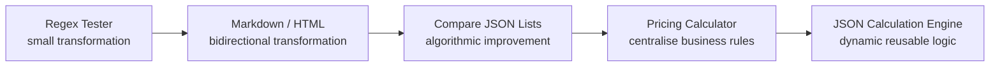

# Power Platform Custom Connector Demo Pack

This folder contains the custom connector designs developed in the conversation.

## Connectors

1. [Regex Tester](01-regex-tester.md)  
   Test a caller-supplied regular expression against text and return match information.

2. [Markdown / HTML Converter](02-markdown-html-converter.md)  
   Convert Markdown to HTML or HTML to Markdown using a direction dropdown.

3. [Compare JSON Lists](03-compare-json-lists.md)  
   Compare two same-schema JSON arrays, including duplicate-aware matches and differences.

4. [Business Rules Calculator](04-business-rules-calculator.md)  
   Combined price/score business-rules example. This is the earlier broad design.

5. [Pricing Calculator](05-pricing-calculator.md)  
   Single-purpose pricing rules example with an applied-rule audit trail.

6. [JSON Calculation Engine](06-json-calculation-engine.md)  
   Apply sequential row calculations dynamically and then calculate aggregate totals.

## Recommended demo sequence



The **Business Rules Calculator** is included for completeness because it was designed in the conversation, but the later **Pricing Calculator** is a cleaner single-purpose version.

## Common architecture

All examples use:

- Swagger / OpenAPI 2.0
- `api.local` as the example host
- HTTPS
- a POST operation
- Power Platform custom C# code using `Script : ScriptBase`
- direct response generation instead of forwarding the request to a backend

```mermaid
flowchart LR
    A[Power Automate] -->|Custom connector action| B[Swagger operation]
    B --> C[C# Script : ScriptBase]
    C --> D[Validate input]
    D --> E[Perform local processing]
    E --> F[HttpResponseMessage]
    F --> A
    C -. no Context.SendAsync .-> G[(api.local not called)]
```

## Important platform note

Microsoft documents that custom code takes precedence over the codeless connector definition for operations to which it is enabled. These examples therefore return directly from C# rather than forwarding the request.

Microsoft documentation:
- https://learn.microsoft.com/en-us/connectors/custom-connectors/write-code
- https://learn.microsoft.com/en-us/connectors/custom-connectors/define-blank
- https://learn.microsoft.com/en-in/connectors/custom-connectors/faq

## Sharing and reuse

Each Markdown file is self-contained and includes:

- title and description,
- architecture/process diagrams,
- equivalent Power Automate flow diagram,
- connector metadata,
- Swagger 2.0,
- complete C# code,
- sample payloads,
- expected responses,
- limitations and extension ideas.

The Mermaid diagrams render directly in GitHub, many Markdown viewers, and documentation platforms that support Mermaid.
